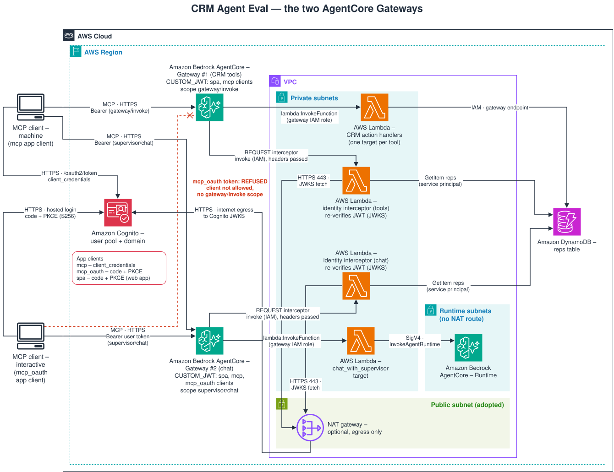

# MCP client guide

See also: [documentation map](../README.md#documentation) · [agentcore module](../infra/modules/agentcore/README.md) · [mcp_chat_gateway module](../infra/modules/mcp_chat_gateway/README.md)

How to connect external MCP clients (the `mcp` Python SDK, Claude Code, MCP Inspector, and similar)
to this stack's two AgentCore Gateways. Values shown as `<...>` come from your own `terraform output`;
this repository commits no account-specific value.

## The two Gateways



| | Gateway #1 (tools) | Gateway #2 (chat) |
|---|---|---|
| MCP URL (root output) | `agentcore_gateway_mcp_url` | `mcp_chat_gateway_url` |
| Tools | every CRM tool in `crm.toolspec.definitions.ALL_TOOLS`, named `<target>___<tool>` | exactly one, `chat-with-supervisor___chat_with_supervisor` |
| Accepted tokens | **machine tokens only**: a `client_credentials` token for the MCP client, scope `gateway/invoke` | a user access token (scope `supervisor/chat`) from the SPA client or the MCP OAuth client, or a `client_credentials` token for the MCP client requesting `supervisor/chat` |
| Interactive OAuth login | not supported | supported: RFC 9728 discovery plus the MCP OAuth client |
| Identity the tools run as | the configured service principal (below) | the signed-in user, or the service principal for a machine token |

Use `agentcore_gateway_mcp_url`, not `agentcore_gateway_url`, for Gateway #1. The deployed
`gatewayUrl` of Gateway #1 is the bare host, and the MCP endpoint is its `/mcp` path.
`mcp_chat_gateway_url` already ends in `/mcp`.

```bash
terraform -chdir=infra output -raw agentcore_gateway_mcp_url
terraform -chdir=infra output -raw mcp_chat_gateway_url
```

Both Gateways speak MCP over streamable HTTP. Gateway #2 declares protocol versions `2025-03-26`,
`2025-06-18` and `2025-11-25`. Gateway #1 declares no protocol configuration (AWS refused that
update in place), so the version is negotiated in the `initialize` handshake from AgentCore's
default; the `mcp` SDK, Claude Code and the Inspector all connect to it. A token is valid only on the Gateway its scope names: a Gateway #2
user token is refused by Gateway #1, and a `gateway/invoke` token is refused by Gateway #2.

## Cognito app clients

The `cognito` module (`infra/modules/cognito/`) provisions three app clients on one user pool:

| Property | SPA (`aws_cognito_user_pool_client.spa`) | MCP (`aws_cognito_user_pool_client.mcp`) | MCP OAuth (`aws_cognito_user_pool_client.mcp_oauth`) |
|---|---|---|---|
| Client type | Public (no secret) | Confidential (`generate_secret` from `var.mcp_client_generate_secret`, default `true`) | Public (no secret) |
| OAuth flow | Authorization code + PKCE | `client_credentials` | Authorization code + PKCE |
| OAuth scopes | `openid`, `email`, `profile` | `gateway/invoke`, `supervisor/chat` | `openid`, `supervisor/chat` (never `gateway/invoke`) |
| Callback URLs | the CloudFront `/callback` | none | `http://localhost:6274/oauth/callback`, `http://localhost:6274/oauth/callback/debug` (MCP Inspector), `http://localhost:33418/callback` (Claude Code `--callback-port 33418`) |
| Token validity | access/id 1 hour, refresh 30 days | access **5 minutes**, no refresh token | access/id 1 hour, refresh 30 days |
| Accepted by | Gateway #2 (user token), the API | Gateway #1 and Gateway #2 | Gateway #2 only |
| Root output | `cognito_spa_client_id` | `cognito_mcp_client_id`, `cognito_mcp_client_secret` (sensitive) | `cognito_mcp_oauth_client_id` |

Every client's `write_attributes` exclude the four scope-bearing custom attributes (`custom:rep_id`,
`custom:book`, `custom:full_visibility`, `custom:tenant`), so a token can never rewrite its own
authorization scope. The pre-token-generation trigger (`src/crm/auth/pre_token_generation.py`, V2
event, user pool tier `ESSENTIALS`) adds the `custom:` claims and the `supervisor/chat` scope to
every **user** access token. It does not run for `client_credentials`.

Cognito does not require PKCE for a public client; the MCP OAuth client's exposure is bounded by its
loopback-only callbacks and its single custom scope. Users are created only by an administrator
(`AdminCreateUser`); there is no self-service sign-up.

## Machine tokens (`client_credentials`)

Read the MCP client's credentials from the root outputs. The `terraform output` recipes for the
secret below hold only until the first secret rotation. After one, the output is empty and the
secret is in the file the rotation wrote; read it from there instead (`secret_path` below is that
file).

```bash
terraform -chdir=infra output -raw cognito_mcp_client_id
terraform -chdir=infra output -raw cognito_mcp_client_secret   # sensitive
terraform -chdir=infra output -raw cognito_token_endpoint
```

The secret output is marked `sensitive`, which only hides it from plan, apply and `terraform output`
display. The value is stored in plaintext in the Terraform state (the KMS-encrypted S3 state bucket),
and `scripts/deploy.sh` also writes it to the gitignored `results/tf-outputs.json`. Restrict read
access to both. This stack creates no Secrets Manager entry for it. To keep a copy there, pass
the value through a `0600` temporary file rather than the command line (a command-line argument is
visible to other users in `ps`), and add `--kms-key-id <key ARN>` to encrypt it with a
customer-managed key:

```bash
umask 077
secret_file="$(mktemp)"
terraform -chdir=infra output -raw cognito_mcp_client_secret > "$secret_file"
# after a rotation: cp "$secret_path" "$secret_file"
aws secretsmanager create-secret \
  --name crm-agent-eval/mcp-client-secret \
  --secret-string "file://${secret_file}" \
  --profile default --region <region> --no-cli-pager
rm -f "$secret_file"
```

Mint a token. Request `gateway/invoke` for Gateway #1, or `supervisor/chat` for Gateway #2. The
client credentials reach `curl` as a config on stdin (`-K -`), written by the shell builtin
`printf`, so the secret is in no process's argument list and its value in no shell history:

```bash
client_id="$(terraform -chdir=infra output -raw cognito_mcp_client_id)"
client_secret="$(terraform -chdir=infra output -raw cognito_mcp_client_secret)"
# after a rotation: client_secret="$(cat "$secret_path")"
printf 'user = "%s:%s"\n' "$client_id" "$client_secret" \
  | curl -s -K - -X POST "<cognito_token_endpoint>" \
      -d "grant_type=client_credentials" \
      -d "scope=gateway/invoke" \
  | jq -r '.access_token'
```

**Secret rotation.** The client id is stable; the secret is rotated in place with
`scripts/rotate_mcp_client_secret.py` (procedure and order in `docs/runbook.md`, "Rotating the MCP
app-client secret"). Cognito keeps the client id, so `allowedClients` on both Gateways is
unaffected and machine tokens still map to the same service principal. After a rotation the old secret is refused with
`invalid_client`. Every `client_credentials` client configured outside this repository needs the new
secret, delivered out of band. After a rotation Cognito no longer returns the secret, so the
`cognito_mcp_client_secret` output is empty and the file the script wrote is the only copy. Read it
from that file rather than reusing an older copy, and pass the file as `--old-secret-file` to the
next rotation.

`client_credentials` cannot request OIDC scopes (`openid`, `email`, `profile`). A machine token lives
**5 minutes**, Cognito's minimum, and there is no refresh token on this grant: a long-lived client
must mint a new token when the old one expires. Use `headersHelper` (Claude Code, below) or mint per
session (SDK) rather than pasting a static header.

### Service-principal identity

A `client_credentials` token carries no `custom:rep_id`/`custom:book`/`custom:full_visibility`
claims. The Gateway REQUEST interceptor (`src/gateway/identity_interceptor.py`) maps it to the one
service principal named by `GATEWAY_SERVICE_PRINCIPAL_REP_ID` (`svc-mcp-gateway`, `infra/main.tf`),
loads that rep's book and tenant from the `reps` table on every call, and writes them into the
`_identity` the action Lambdas enforce against.

- **Reachable data is that one rep's book.** Anything outside it answers `scope_denied`.
- **Nothing you send can change it.** A caller-supplied `_identity`, `_agent_identity` or
  `requestContext` in `params.arguments` is stripped before the verified identity is written.
- **It fails closed.** No configured principal, or a `reps` item that is missing, names no tenant,
  carries no explicit `book`, or asks for `full_visibility`, refuses every tool call with
  `authentication_failed`.

Both Gateways' interceptors map a machine token to this same principal (`infra/main.tf` and
`infra/mcp_chat_gateway.tf` both set `GATEWAY_SERVICE_PRINCIPAL_REP_ID`), so machine-token calls on
either Gateway need the row below.

**Operator step.** The `svc-mcp-gateway` row in `reps` is data, not infrastructure, and no script
provisions it for the deployed stack. Until an operator writes it (with a `tenant`, an explicit
`book`, and no `full_visibility`), every machine-token tool call on either Gateway is refused
`authentication_failed`.

**The smoke modules remove that row.** `scripts.smoke.gateway_tools` (Layer 4) and
`scripts.smoke.mcp_client_compat` (Layer 5) each overwrite the `svc-mcp-gateway` row with a
disposable smoke tenant's book and delete it in their cleanup. After any run that includes either
module, including an `--only` run such as the one under Verification, repeat the operator step
before using a machine token again.

## Recipes

### `mcp` Python SDK

```python
import anyio
from mcp import ClientSession
from mcp.client.streamable_http import create_mcp_http_client, streamable_http_client


async def main(url: str, token: str) -> None:
    headers = {"Authorization": f"Bearer {token}"}
    async with create_mcp_http_client(headers=headers) as http_client:
        async with streamable_http_client(url, http_client=http_client) as (read, write):
            async with ClientSession(read, write) as session:
                await session.initialize()
                tools = await session.list_tools()
                print([tool.name for tool in tools.tools])


anyio.run(main, "<agentcore_gateway_mcp_url>", "<machine token>")
```

`scripts/smoke/mcp_client_compat.py` is the tested version of this client (Layer 5, below).

### Claude Code

Gateway #1, with a token minted at connect time by `headersHelper`, a command Claude Code runs
when it connects and whose output is a JSON object of headers. This is the variant run against the
deployed stack: it reads the client secret from the `CRM_MCP_CLIENT_SECRET` environment variable,
inherited from the shell that starts Claude Code, and passes it to `curl` on stdin. Use an absolute
path, because whether Claude Code expands `~` in `headersHelper` was not verified:

```bash
cat > /absolute/path/crm-gateway-headers.sh <<'HELPER'
#!/usr/bin/env bash
set -euo pipefail
token="$(printf 'user = "%s:%s"\n' "<cognito_mcp_client_id>" "${CRM_MCP_CLIENT_SECRET:?}" \
  | curl -sf -K - -X POST "<cognito_token_endpoint>" \
      -d grant_type=client_credentials -d scope=gateway/invoke \
  | jq -r .access_token)"
printf '{"Authorization": "Bearer %s"}\n' "$token"
HELPER
chmod 700 /absolute/path/crm-gateway-headers.sh
```

To read the secret from the Secrets Manager copy instead, replace `${CRM_MCP_CLIENT_SECRET:?}` with
`$(aws secretsmanager get-secret-value --secret-id crm-agent-eval/mcp-client-secret --query
SecretString --output text --profile default --region <region> --no-cli-pager)`. That variant has
not been run against the deployed stack.

Register the server. `claude mcp add-json` stores this JSON in Claude Code's own MCP configuration:

```bash
claude mcp add-json crm-tools '{
  "type": "http",
  "url": "<agentcore_gateway_mcp_url>",
  "headersHelper": "/absolute/path/crm-gateway-headers.sh"
}'
```

Gateway #2 with a static bearer header. Claude Code stores the user access token in plaintext in
its MCP configuration. The token expires after 1 hour, and the server then stops connecting until
you re-add it with a fresh token:

```bash
claude mcp add --transport http crm-chat "<mcp_chat_gateway_url>" \
  --header "Authorization: Bearer <user access token>"
```

Gateway #2 with OAuth, so Claude Code runs the login itself. It has its own server name, so it can
coexist with the header recipe:

```bash
claude mcp add --transport http crm-chat-oauth "<mcp_chat_gateway_url>" \
  --client-id "<cognito_mcp_oauth_client_id>" --callback-port 33418
```

`claude mcp list` reports `crm-chat-oauth` as `Needs authentication` until you sign in. Run `/mcp`
inside Claude Code and choose the server to authenticate. A browser opens on the
Cognito hosted login page; after sign-in Cognito redirects to `http://localhost:33418/callback`.
`claude mcp list` reports `crm-tools` as `Connected`, and `crm-chat` as `Connected` while its token
is valid.

### MCP Inspector

CLI mode, against either Gateway, with a token you minted:

```bash
npx --yes @modelcontextprotocol/inspector@2.11.0 --cli "<gateway MCP URL>" \
  --transport http --method tools/list \
  --header "Authorization: Bearer <token>"
```

UI mode with OAuth, Gateway #2 only:

1. `npx --yes @modelcontextprotocol/inspector@2.11.0` and open the printed `localhost:6274` URL.
2. Transport **Streamable HTTP**, URL `<mcp_chat_gateway_url>`.
3. Under Authentication, set the OAuth client id to `<cognito_mcp_oauth_client_id>` (no secret) and
   the scope to `openid supervisor/chat`.
4. Connect. The Inspector discovers the authorization server from the Gateway's 401
   (`WWW-Authenticate` `resource_metadata`), opens the Cognito login, and receives the code on
   `http://localhost:6274/oauth/callback`.

## The interactive login (owner-run)

The browser sign-in itself needs a real user and a person at the keyboard, so no automated check in
this repository performs it. To run it:

1. An administrator creates the user (`AdminCreateUser`) with its `custom:` scope attributes.
2. Run one of the two OAuth recipes above (Claude Code `/mcp`, or Inspector UI).
3. Sign in on the Cognito page, set the permanent password, and enrol TOTP if MFA is required.
4. Confirm the client lists `chat_with_supervisor`.
5. Present the resulting `mcp_oauth` access token to Gateway #1 once, for example with the
   Inspector CLI recipe and `<agentcore_gateway_mcp_url>`. Expect a 401 or 403 refusal, and record
   the status in the spec's test evidence. No automated check can obtain an `mcp_oauth` token, so
   until this step runs, Gateway #1's refusal of that client is deduced from its live configuration
   (its allowed clients exclude the `mcp_oauth` id, and its only scope is `gateway/invoke`), not
   observed.

What is checked automatically is everything up to the login page: the discovery chain, that the
authorize endpoint accepts this client id with an S256 PKCE challenge and the Inspector callback,
and that the client cannot obtain `gateway/invoke` (below). Cognito refuses that scope by
redirecting to the callback with `error=invalid_request&error_description=invalid_scope`, and
refuses an unregistered callback with `error=redirect_mismatch`.

## What the Gateway does with every request

Every `tools/call` request passes through the REQUEST interceptor before it reaches a Lambda:


1. The interceptor configuration sets `passRequestHeaders: true` so the interceptor can read the
   `Authorization` header.
2. The interceptor re-verifies the bearer token against Cognito's JWKS (cached): signature, `exp`,
   `iss`, the client id against that Gateway's allowed clients, `token_use`, and that Gateway's
   scope. It never trusts a claim in the request body.
3. It discards any identity-channel key in the tool-call arguments, then injects its own verified
   identity. `tools/list` needs no identity and passes through unmodified.
4. A missing or malformed identity at the Lambda boundary is refused, never given a default.

The toolspec's schema-level guard (`additionalProperties: false`, an explicit deny on `_identity`) is
**not** enforced at the Gateway: AgentCore's `SchemaDefinition` has no `additionalProperties` field,
so an undeclared argument is forwarded. The interceptor's strip in step 3 is the only defence at the
Gateway; each handler's toolspec-derived validator applies the schema guard one layer in.

## Verification

- `scripts/smoke/mcp_client_compat.py` (Layer 5, `docs/runbook.md`) drives both Gateways with the
  `mcp` SDK: the handshake and `tools/list` on each, one read-only `tools/call` on Gateway #1, 401 for
  an unauthenticated connect, Gateway #2's discovery chain up to the login page for the MCP OAuth
  client, `invalid_scope` for `gateway/invoke`, and refusal of the Gateway #2 user token by Gateway #1.
- `scripts/smoke/mcp_chat_gateway.py` (Layer 5) covers Gateway #2's model-backed call and its denials.
- `scripts/smoke/integration_gateway_scope.py` (Layer 5) covers Gateway #1's scope enforcement and
  forged-identity stripping with this project's own JSON-RPC client; `scripts/smoke/gateway_tools.py`
  (Layer 4) covers its `tools/list` parity and the expired- and underscoped-token refusals.
- Run them against a deployed dev stack:

  ```bash
  bash scripts/verify_deployment.sh --i-understand-this-is-billable \
    --only scripts.smoke.mcp_client_compat,scripts.smoke.mcp_chat_gateway
  ```
